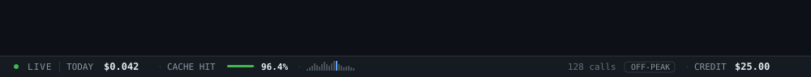

# dshCostWatchPlugin

`dsh-costwatch-plugin` is a DeepSeek Harness Web plugin that shows **today’s model spend
in USD**, **the account’s remaining credit**, and **today’s prompt cache hit
rate** in a slim status bar along the bottom of the Harness window.



## What it shows

- **USD today** — each committed `assistant/message` usage record is priced at
  the DeepSeek list rate for its model and the peak/off-peak window containing
  the call. Cache reads and cache writes are priced separately from uncached
  input.
- **Credit** — the API key account’s remaining balance from the official
  `GET /user/balance` endpoint, including granted and topped-up amounts. It is
  cached for 60 seconds; a failed refresh keeps the last known amount.
- **Cache hit rate today** — `cacheRead / (input + cacheRead + cacheWrite)`
  across the same calls.
- **Hourly sparkline** — today’s cost bucketed by local hour, with the current
  hour accented.
- **Window badge** — `PEAK` or `OFF-PEAK` for the current instant.
- **Call count** and a full token, wallet, and refresh breakdown in the hover
  title.

The bar polls the Host every two seconds, so usage updates as the agent works
and credit refreshes once a minute. Polling backs off to 30 seconds while the
Host is unreachable.

## Install

After this package is published:

```sh
dsh plugin --profile web add dsh-costwatch-plugin
```

Then enable **dshCostWatchPlugin** on the Web **Plugins** page. For a local checkout,
pass the package directory instead:

```sh
dsh plugin --profile web add /absolute/path/to/dsh-costwatch-plugin
```

## Data and pricing

The Host half folds today’s calls from the canonical Session logs on startup
(so usage from before the plugin loaded is included) and then follows the live
`session/event` firehose. Assistant messages and compaction summarization
calls both count. Each call is deduplicated by its Session sequence cursor;
the collector keeps no durable totals of its own.

Prices are USD per 1M tokens from the official
[DeepSeek rate card](https://api-docs.deepseek.com/quick_start/pricing)
(November 2026):

| Model | Cache hit | Cache miss | Output |
| --- | ---: | ---: | ---: |
| `deepseek-flash` / `deepseek-v4-flash` | $0.003 off / $0.006 peak | $0.15 off / $0.30 peak | $0.60 off / $1.20 peak |
| `deepseek-v4-pro` | $0.022 off / $0.044 peak | $0.66 off / $1.32 peak | $1.98 off / $3.96 peak |

Peak hours are 01:00–04:00 and 06:00–10:00 UTC on weekdays, excluding Chinese
public holidays (the 2026 holiday calendar is built in). Legacy ids
`deepseek-chat` and `deepseek-reasoner` bill at the Flash rate.

Credit comes from the official
[`GET /user/balance`](https://api-docs.deepseek.com/api/get-user-balance)
endpoint, authenticated with the same `DEEPSEEK_API_KEY` credential reference
the model route resolves. It reports the remaining total (topped up plus
granted) per currency, so a USD account reads `$25.00` and a CNY account
`¥110.00`. No platform sign-in is required.

### Configuration

All fields are optional; the defaults target the official API and the standard
credential reference.

| Field | Default | Meaning |
| --- | --- | --- |
| `apiKeyEnv` | `DEEPSEEK_API_KEY` | Credential reference resolved through `ctx.credentials`. |
| `balanceURL` | `https://api.deepseek.com/user/balance` | Balance endpoint. HTTPS is required except for a loopback proxy; embedded credentials are refused. |
| `balanceRefreshMs` | `60000` | Minimum age before the cached credit is refreshed (clamped to at least 5 s). |
| `balanceTimeoutMs` | `15000` | Per-refresh request timeout (clamped to at least 1 s). |
| `holidays` | built-in 2026 Chinese holidays | Additional Beijing dates (`YYYY-MM-DD`) billed at the off-peak rate all day. |

## Privacy and data access

- **Local reads only for usage.** `dsh-costwatch-plugin` opens the local Session logs
  through `sessionPersistence` and reads token counts, timestamps, and model
  ids from `assistant/message` and `compaction/summary` events. Conversation
  text, prompts, tool arguments/results, attachments, and Session ids are
  never retained by the plugin, never written to disk, and never sent
  anywhere.
- **One outbound request.** The only network call is `GET /user/balance` to
  the configured balance endpoint: once at plugin start and then at most once
  per minute while a page is open. It carries the API key in the
  `Authorization` header and nothing else from the Session.
- **The key never leaves the Host.** The key is resolved per refresh through
  `ctx.credentials`, is not stored by the plugin, is not included in the
  snapshot, the browser bundle, logs, or documentation.
- **The snapshot is owner-only.** `GET /api/dsh-costwatch-plugin` is registered through
  `ctx.connection.fetch`, which admits only the authenticated owner browser
  peer. Non-owner peers receive the channel's normal refusal.
- **No telemetry, analytics, file writes, or third-party services.**

## Permissions

| Host service | Purpose |
| --- | --- |
| `connection` | Register the owner-authenticated snapshot route. |
| `sessionPersistence` | Read today’s token usage from the local Session logs. |
| `credentials` (optional) | Resolve the API-key reference for the credit request. |

The browser half only requires the platform’s `react` seed and registers one
entry in the `shell.bottom` slot. It makes same-origin requests only.

## Security notes

- The balance request sets `redirect: 'error'`, a bounded timeout, and reduces
  failures to safe categories (`HTTP 4xx/5xx`, `timeout`, `network error`,
  `invalid response`) instead of surfacing raw messages.
- `balanceURL` is validated before use: HTTPS is required unless the host is
  loopback, embedded credentials are refused, and redirects are not followed.
- Provider usage values are coerced to non-negative finite numbers; malformed
  events cannot poison totals or the sparkline.
- Wallet amounts are parsed from the server’s decimal strings and displayed as
  text; no value from the API is executed or injected as markup.
- Usage-derived figures in this README and the test suite are synthetic
  examples, not a real account history.

## Requirements and composition

- DeepSeek Harness Web profile with `connection` and `sessionPersistence` Host
  services; `credentials` is optional (without it the bar shows `CREDIT —`).
- Declared DSH range: `>=0.2.2-rc.1`.
- The browser half registers itself in the frame’s `shell.bottom` seat, so it
  is mounted on every page and survives navigation.

The bundle patch inserts one Host entry; the same package declares
`dsh.client`, so the Host entry also supplies the browser bundle at
`/plugins/dsh-costwatch-plugin/client.js`.

## Notes and limits

- Spend is computed from provider token usage, not from the platform invoice;
  Search/Fetch API fees and other non-model charges are excluded from the
  estimate but are reflected in the credit balance.
- Credit is the API key account’s wallet, read from the official balance
  endpoint, not the platform login’s account view. A deployment with no
  resolvable API key shows `CREDIT —` while the usage ticker keeps working.
- The model price table is DeepSeek-specific; other providers show usage
  tokens but price at the Flash fallback and appear under `unpricedModels`.
- The local day follows the Host’s time zone, so “today” rolls over at local
  midnight.
- `shell.bottom` is a single slot; another plugin occupying it would shadow one
  of the two bars.

## Development

```sh
node --test test/*.test.mjs
```

## License

MIT — see [LICENSE](LICENSE).
